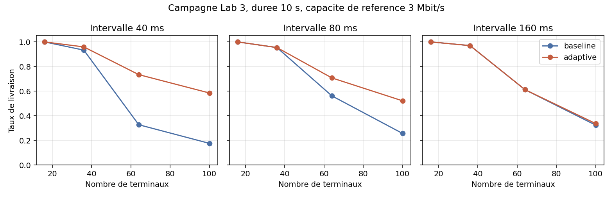
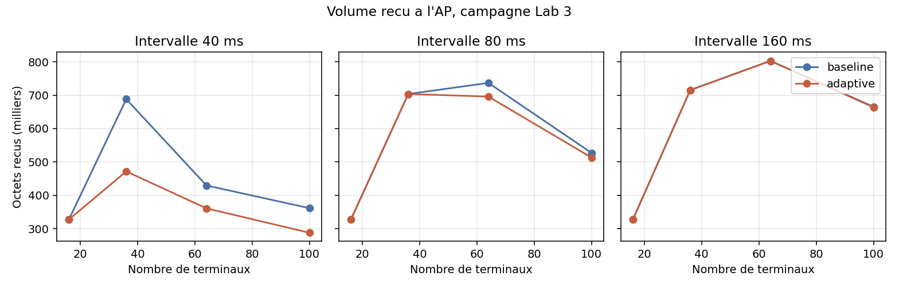
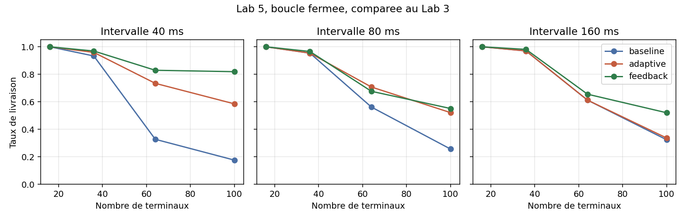
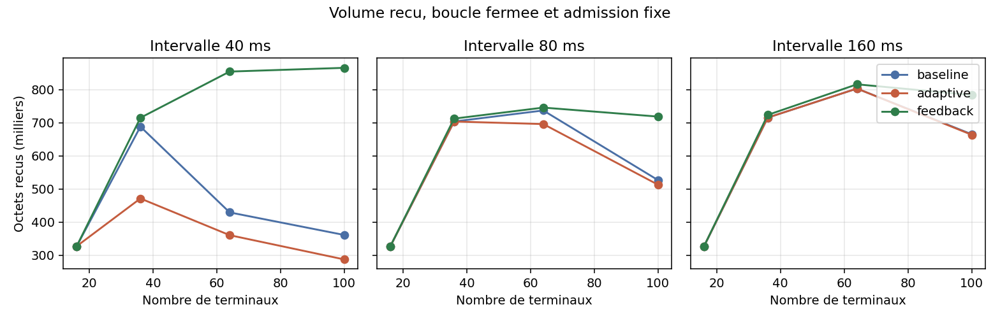

# ns3_IMT2030_connectivity

[](https://www.nsnam.org/)
[](labs/lab01_wifi_dense/)
[](docs/CADRE_IMT2030.md)
[](labs/lab03_controleur/scripts/)
[](docs/latex/rapport_general.pdf)
[](LICENSE)

Progression en cinq laboratoires sur la connectivité dense et le contrôle d'admission, avec ns-3.43 sous WSL. Le dépôt ne simule pas une pile 6G complète. Il compare des politiques de charge sur une zone représentative, d'abord en Wi-Fi, puis sur une cellule NR réduite.

Synthèse courte : [docs/BILAN.md](docs/BILAN.md). Cadre IMT-2030 : [docs/CADRE_IMT2030.md](docs/CADRE_IMT2030.md). Planning : [PLANNING.md](PLANNING.md).

## Objectif

La vision IMT-2030, dans la ligne de la recommandation ITU-R M.2160, vise un ordre de grandeur d'un million à cent millions d'équipements par kilomètre carré. Ce dépôt fixe une question plus étroite, mais compatible avec cette perspective. Sur une grille de 16 à 100 terminaux espacés de 5 m, une règle qui limite ou réordonne les émetteurs modifie-t-elle le nombre de paquets UDP qui arrivent au point de collecte, et à quel prix sur le taux de livraison des paquets réellement émis ?

Trois niveaux ne doivent pas être confondus. La vision IMT-2030 reste l'échelle cible. Le modèle simulé est une grille carrée autour d'un seul point d'accès ou d'un gNB. La mesure est celle de ns-3 sur Wi-Fi `HtMcs7`, puis sur une cellule NR de 20 MHz au Lab 4. Aucun run ne couvre un kilomètre carré à l'échelle IMT.

## Résultats

1. Le Lab 1 pose le scénario, le CSV et la distinction entre émission simultanée et admission. La grille et la topologie sont visibles sur les figures ci-dessous.

2. Le Lab 2 exécute 24 runs avec `UdpClient`. Sur 100 terminaux et 40 ms, la livraison vaut 0,186. La politique adaptive enregistre 50 événements sans modifier les octets reçus. Ce CSV est une archive. Le source actuel ne le reproduit plus.

3. Le Lab 3 remplace `UdpClient` par des sockets planifiés et une admission permanente. À 100 terminaux et 40 ms, la baseline reçoit 706 paquets sur 4 000 émis. L'admission fixe en reçoit 562 sur 960, avec un taux de 0,585 et 24 flux actifs. Le taux monte et le volume baisse.

4. Le Lab 4 compile 5G-LENA v3.3.1 dans `contrib/nr`. Sur 16 terminaux, les trois politiques reçoivent 327 680 octets et livrent tous les paquets. Au-delà de 16 terminaux, la simulation s'arrête dans le RRC idéal avant le trafic.

5. Le Lab 5 ajoute la politique `feedback`. Le plafond part du Lab 3 et s'ajuste toutes les 0,5 s. À 100 terminaux et 40 ms, 1 690 paquets arrivent sur 2 063 émis, soit un taux de 0,819 et 56 flux. La boucle n'est pas un modèle entraîné.

6. La densité spatiale de la grille 10×10 vaut environ 4,9×10⁴ terminaux par km². Elle reste environ vingt fois sous un million, et très loin de cent millions par km².










### Lecture rapide à 100 terminaux, 40 ms, 512 octets

| Politique | Paquets émis | Paquets reçus | Taux | Flux |
|-----------|-------------:|--------------:|-----:|-----:|
| baseline | 4 000 | 706 | 0,177 | 100 |
| adaptive | 960 | 562 | 0,585 | 24 |
| feedback | 2 063 | 1 690 | 0,819 | 56 |

Les chiffres Wi-Fi proviennent du binaire actuel et du CSV du Lab 3 ou Lab 5. Ils ne sont pas des mesures NR.

## Méthode

Le scénario principal est `labs/lab01_wifi_dense/scenario/imt2030-density-gestion.cc`. Il doit être copié dans `ns-3.43/scratch/projet-visuel-imt2030/` avant compilation. Les campagnes Python écrivent `sorties/resultats.csv` dans chaque laboratoire. Les rapports PDF sont dans `docs/latex/`.

| Lab | Dossier | Rôle | Rapport |
|-----|---------|------|---------|
| 1 | [labs/lab01_wifi_dense](labs/lab01_wifi_dense/) | Scénario, figures, captures | [rapport_lab01.pdf](docs/latex/rapport_lab01.pdf) |
| 2 | [labs/lab02_campagne](labs/lab02_campagne/) | Plan factoriel, archive `UdpClient` | [rapport_lab02.pdf](docs/latex/rapport_lab02.pdf) |
| 3 | [labs/lab03_controleur](labs/lab03_controleur/) | Admission permanente, 24 runs | [rapport_lab03.pdf](docs/latex/rapport_lab03.pdf) |
| 4 | [labs/lab04_5g_lena](labs/lab04_5g_lena/) | Cellule NR, 16 terminaux | [rapport_lab04.pdf](docs/latex/rapport_lab04.pdf) |
| 5 | [labs/lab05_ai_native](labs/lab05_ai_native/) | Boucle fermée, 12 runs | [rapport_lab05.pdf](docs/latex/rapport_lab05.pdf) |

Les métriques communes sont les octets reçus, l'offre estimée à partir des paquets réellement envoyés, le taux de livraison, l'indice de Jain sur les flux de volume strictement positif, le compteur d'événements d'admission, le nombre de flux ayant émis, et le plafond final à 10 s. La capacité de 3 Mbit/s sert à calculer le plafond initial K. Elle ne mesure pas le débit `HtMcs7` ni la bande NR.

La loi d'admission fixe laisse émettre les terminaux d'indice inférieur à K, avec K borné par la population. La boucle `feedback` part de la même valeur, puis réduit K si la livraison de la fenêtre est inférieure à 0,35, et l'augmente si elle est supérieure à 0,50. Chaque terminal s'arrête après 40 paquets.

## Organisation du dépôt GitHub

Le dépôt ne contient pas l'arborescence `ns-allinone-3.43` complète. Il contient `projet-visuel-imt2030/` seulement. Le module NR se clone dans `ns-3.43/contrib/nr` en local. Il n'est pas versionné ici.

Une publication lab par lab convient à une lecture séquentielle. L'ordre recommandé est le suivant : socle commun et Lab 1, puis Lab 2, Lab 3, Lab 4, Lab 5, enfin README complet et PDF si vous ne les avez pas déjà poussés au fil des commits.

## Reproduction minimale

Prérequis : WSL Ubuntu, ns-3.43 compilé, Python 3, matplotlib pour les figures des Labs 2 à 5, pdflatex pour les PDF.

```bash
cd /chemin/vers/ns-3.43
cp -r ../projet-visuel-imt2030/labs/lab01_wifi_dense/scenario/* scratch/projet-visuel-imt2030/
./ns3 build scratch/projet-visuel-imt2030/imt2030-density-gestion
```

Lab 1, run manuel :

```bash
./ns3 run "scratch/projet-visuel-imt2030/imt2030-density-gestion --policy=baseline --gridSide=10 --simTime=12 --intervalMs=40"
```

Lab 3, campagne 24 runs après copie du scénario :

```bash
python3 ../projet-visuel-imt2030/labs/lab03_controleur/scripts/lancer_campagne.py
python3 ../projet-visuel-imt2030/labs/lab03_controleur/scripts/analyser_campagne.py
```

Lab 4, trois runs NR après installation de 5G-LENA v3.3.1 dans `contrib/nr` et build de `imt2030-nr-gestion` :

```bash
python3 ../projet-visuel-imt2030/labs/lab04_5g_lena/scripts/lancer_campagne.py
```

Lab 5 :

```bash
python3 ../projet-visuel-imt2030/labs/lab05_ai_native/scripts/lancer_campagne.py
python3 ../projet-visuel-imt2030/labs/lab05_ai_native/scripts/analyser_campagne.py
```

Ne pas relancer le script du Lab 2 si vous voulez conserver l'archive `UdpClient`. Ne pas relancer le Lab 3 si vous voulez conserver l'ancien CSV sans colonne `finalCap`.

## Rapports PDF

[rapport_general.pdf](docs/latex/rapport_general.pdf) synthétise les cinq labs. Chaque lab possède son PDF dans [docs/latex/](docs/latex/). Les sources `.tex` s'y trouvent aussi.

## Limites

Une seule graine a été utilisée sur les campagnes. Les seuils 0,35 et 0,50 sont des choix de protocole. L'admission suit l'indice de création des stations. Le Lab 4 sur ns-3.43 emploie une étiquette 5G-LENA prévue pour ns-3.42. Le plan NR complet n'a pas été exécuté.

## Licence

MIT. Voir [LICENSE](LICENSE).
