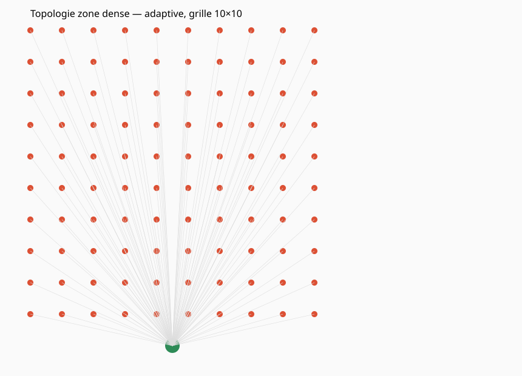
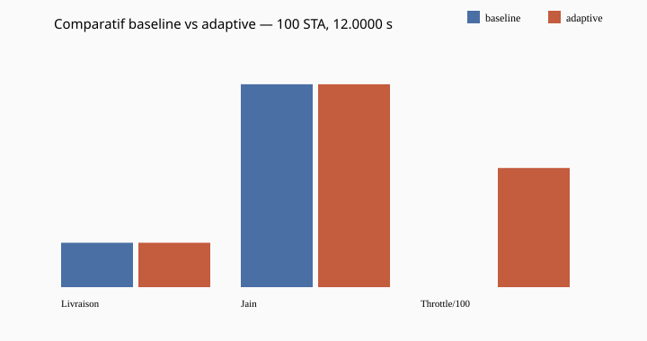
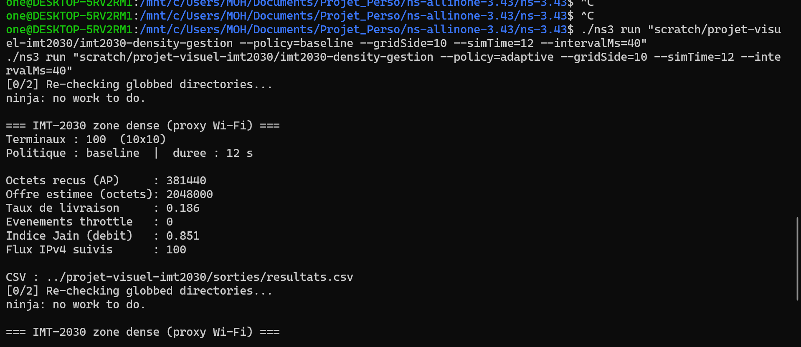
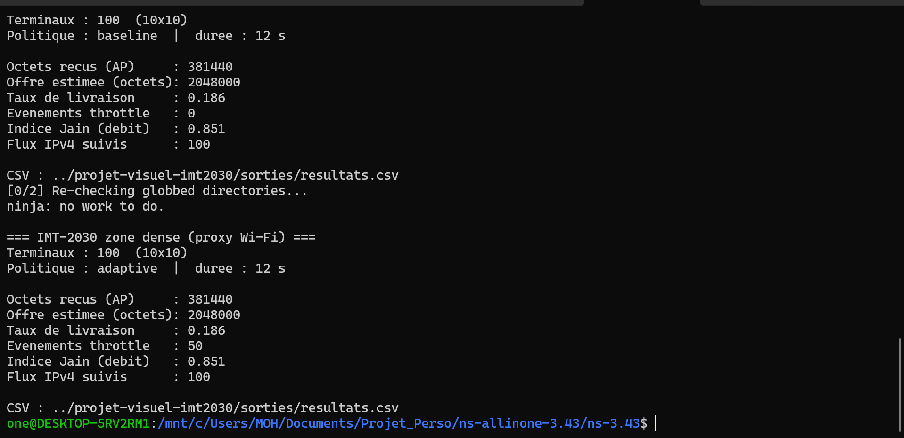

# Simulation ns-3 : zone dense et gestion de charge (cadre IMT-2030)

[](scenario/imt2030-density-gestion.cc)
[](scenario/)
[](scenario/imt2030-density-gestion.cc)
[](https://www.itu.int/rec/R-REC-M.2160)
[](scripts/generer_toutes_les_images.py)
[](README.md)
[](LICENSE)

Prototype de recherche (WIP). Une grille de terminaux Wi-Fi émet du trafic UDP vers un point d'accès. Deux politiques sont comparées : **baseline** (aucune gestion) et **adaptive** (contrôle heuristique de charge inspiré des boucles d'admission / zero-touch). Les métriques sont exportées en CSV. Le modèle radio est un proxy IoT / mMTC ; une extension 5G-LENA est prévue.

Ce dépôt ne simule pas la pile 6G complète. Il documente une **zone représentative à forte densité** et une méthodologie reproductible (baseline, variante, mesures).

## Résultats

1. Campagne **10×10 terminaux**, 12 s, `--intervalMs=40` : taux de livraison vers l'AP d'environ **0,186**, indice de Jain **0,851**, **100 flux** IPv4 suivis (FlowMonitor).

2. Même scénario, politique **baseline** : **0** événement de gestion (`throttleEvents`).

3. Même scénario, politique **adaptive** : **50** événements de mise en veille / reprise ; livraison observée identique sur cette version du contrôleur (v0 compte les actions avant d'optimiser le débit utile).

4. Grille **8×8**, charge modérée : livraison d'environ **0,567**, Jain **0,939** ; le contrôleur ne s'active pas si l'offre agrégée reste sous le seuil `rho`.

5. Sorties reproductibles : `sorties/resultats.csv`, figures SVG, captures terminal dans `docs/img/`.

## Aperçu visuel

| Topologie | Comparatif baseline / adaptive |
|-----------|-------------------------------|
|  |  |

**Terminal (100 STA, charge forte)** :





Page locale regroupant toutes les figures : [sorties/portfolio_visuel.html](sorties/portfolio_visuel.html) (ouvrir dans le navigateur).

## Objectifs du projet

**1. Poser un scénario ns-3 dense et paramétrable.** Grille `gridSide²`, trafic UDP, point d'accès central, métriques console + CSV.

**2. Comparer gestion vs référence.** Politique `adaptive` (seuils `highUtil` / `lowUtil`, capacité de référence) face au `baseline`.

**3. Préparer l'axe 6G / AI-native.** Place-holder de contrôle RAN avant 5G-LENA, ns-O-RAN ou apprentissage (ns3-gym). Narration alignée sur les usages **connectivité massive** (ITU-R M.2160).

## Prérequis

| Élément | Remarque |
|---------|----------|
| ns-3.43 (ou proche) | Dépot allinone, compilation cmake/ninja |
| WSL Ubuntu (Windows) | Commandes `./ns3` testées sous WSL |
| Python 3 | Optionnel : `scripts/generer_toutes_les_images.py` |
| NetAnim | Optionnel ; export `imt2030-animation.xml` si besoin |

## Installation du scénario

Copier `scenario/` dans `ns-3.43/scratch/projet-visuel-imt2030/` :

```bash
cd /chemin/vers/ns-3.43
./ns3 build scratch/projet-visuel-imt2030/imt2030-density-gestion
```

## Utilisation

```bash
# Référence
./ns3 run "scratch/projet-visuel-imt2030/imt2030-density-gestion --policy=baseline --gridSide=10 --simTime=12 --intervalMs=40"

# Gestion de charge
./ns3 run "scratch/projet-visuel-imt2030/imt2030-density-gestion --policy=adaptive --gridSide=10 --simTime=12 --intervalMs=40"

# Figures pour README / rapport
python3 /chemin/vers/projet-visuel-imt2030/scripts/generer_toutes_les_images.py
```

Paramètres utiles : `--gridSide`, `--simTime`, `--intervalMs`, `--capacityMbps`, `--enableAnim=0` (désactiver XML NetAnim).

## Algorithme `adaptive` (v0)

1. Toutes les **0,5 s** : estimer `rho = débit offert actif / capacité de référence` (défaut 8 Mbit/s).
2. Si `rho > 0,82` : mise en veille d'environ **25 %** des terminaux actifs (tour par tour).
3. Si `rho < 0,55` : reprise d'un terminal en veille.

## Métriques

| Symbole CSV | Signification |
|-------------|----------------|
| `deliveryRatio` | Octets reçus / offre estimée |
| `throttleEvents` | Actions du contrôleur |
| `jainFairness` | Équité entre flux |
| `bytesRx` | Octets reçus au point d'accès |

## Structure du dépôt

```
projet-visuel-imt2030/
├── README.md
├── LICENSE
├── scenario/              # sources ns-3 (scratch)
├── scripts/               # génération SVG / portfolio HTML
├── sorties/               # resultats.csv, figures
├── docs/img/              # captures terminal
├── CAPTURES.md            # guide captures écran
└── docs/BILAN.md          # synthèse courte
```

## Limites

- Wi-Fi 802.11n, pas NR/5G.
- `capacityMbps` est un paramètre de référence, pas un débit PHY mesuré.
- Pas de mobilité (grille fixe).
- Offre estimée = paquets prévus ; retransmissions MAC simplifiées.

## Suite

1. Campagne multi-`gridSide` et graphiques depuis `resultats.csv`.
2. 5G-LENA + métriques RAN (PRB, PDB).
3. Contrôleur ML (ns3-gym) sur les mêmes métriques.

## Publication

```bash
cd projet-visuel-imt2030
git remote add origin https://github.com/Traorehub/VOTRE_NOM_DE_DEPOT.git
git push -u origin main
```
