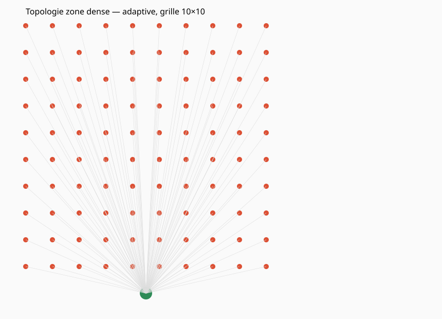
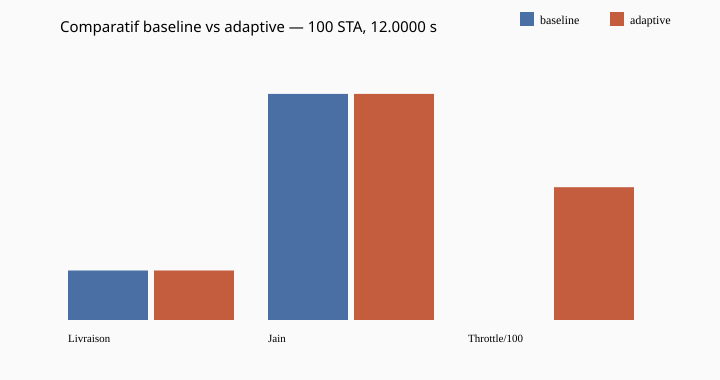
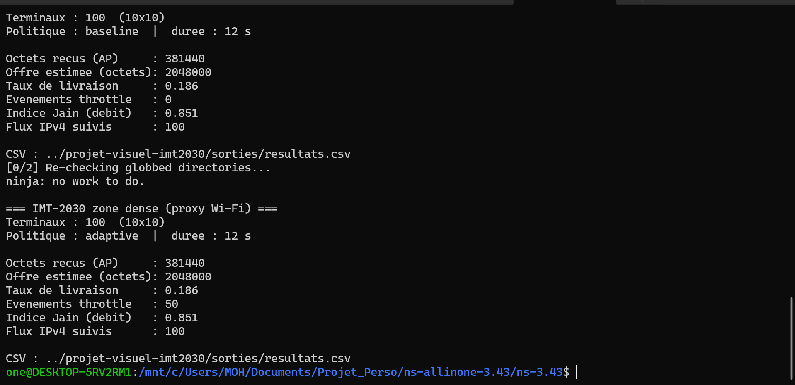

# Lab 1 — Zone dense Wi-Fi (proxy connectivite massive)

Ce laboratoire heberge le scenario principal `imt2030-density-gestion.cc`. La couche d'acces est du Wi-Fi 802.11n avec `YansWifiPhyHelper`, gestionnaire de debit `HtMcs7` et SSID `imt2030-dense-zone`. Le cadre IMT-2030 s'applique au **probleme** (densite, comparaison baseline / adaptive), pas au standard radio simule.

## Stack radio effective (a citer en rapport)

Le standard fixe est `WIFI_STANDARD_80211n`. Le canal et la physique passent par Yans. Les terminaux envoient du UDP vers un point d'acces. Aucun module NR ni 5G-LENA n'est charge dans ce lab.

## Installation

Copiez le dossier `scenario/` dans `ns-3.43/scratch/projet-visuel-imt2030/`, puis lancez la compilation depuis la racine ns-3.

```bash
cd /chemin/vers/ns-3.43
./ns3 build scratch/projet-visuel-imt2030/imt2030-density-gestion
```

Les sorties par defaut vont dans `labs/lab01_wifi_dense/sorties/` lorsque vous executez depuis l'arborescence ns-allinone habituelle. Vous pouvez changer le chemin avec `--outputDir`.

## Campagne de reference

```bash
./ns3 run "scratch/projet-visuel-imt2030/imt2030-density-gestion --policy=baseline --gridSide=10 --simTime=12 --intervalMs=40"
./ns3 run "scratch/projet-visuel-imt2030/imt2030-density-gestion --policy=adaptive --gridSide=10 --simTime=12 --intervalMs=40"
```

Sur cette campagne, la livraison vers l'AP est d'environ 0,186 pour les deux politiques. La politique adaptive enregistre 50 evenements de gestion alors que la baseline n'en enregistre aucun.

## Figures

Le script `scripts/generer_toutes_les_images.py` lit `sorties/resultats.csv` et produit les SVG ainsi que `sorties/portfolio_visuel.html`. Les captures terminal se trouvent dans `docs/img/`.







## Politique adaptive (version 0)

Toutes les 0,5 s, le controleur estime le rapport entre l'offre des terminaux actifs et une capacite de reference. Il met une fraction des terminaux en veille lorsque le seuil haut est depasse, puis en reactive un lorsque le seuil bas est atteint.

## Limites du lab

La grille est fixe. La capacite de reference est un parametre. L'offre estimee se fonde sur le nombre de paquets prevus. Ces limites doivent figurer dans toute presentation scientifique.
